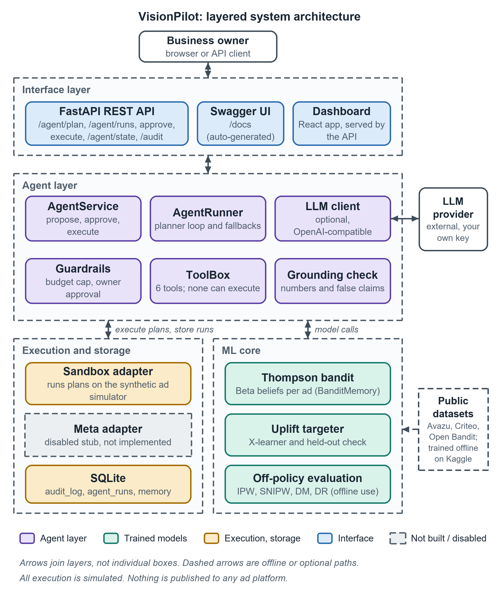
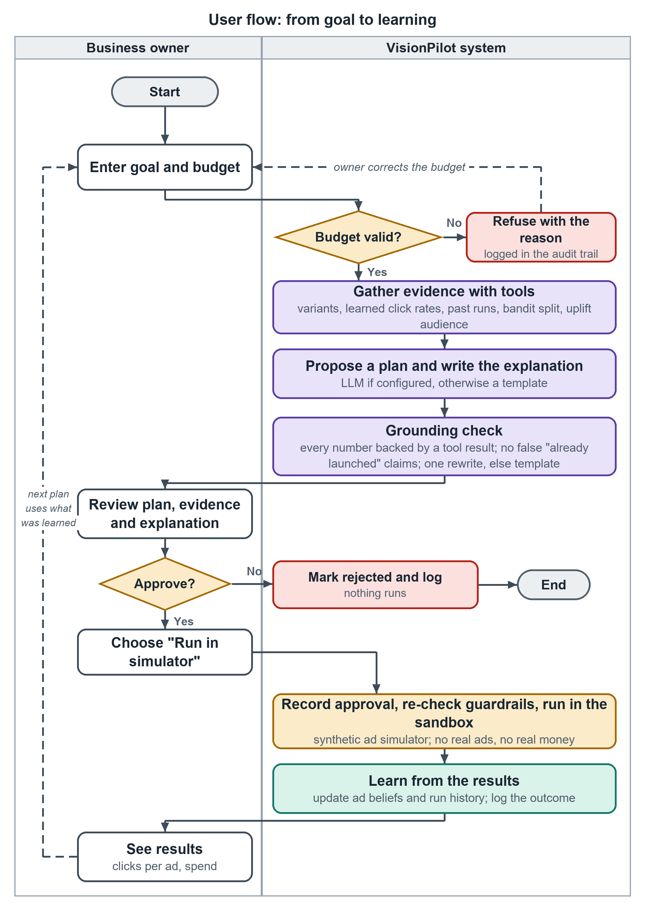
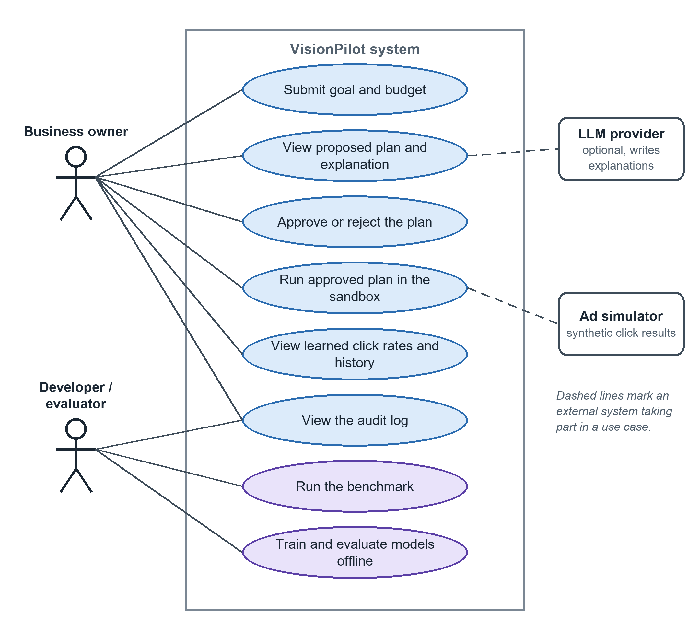
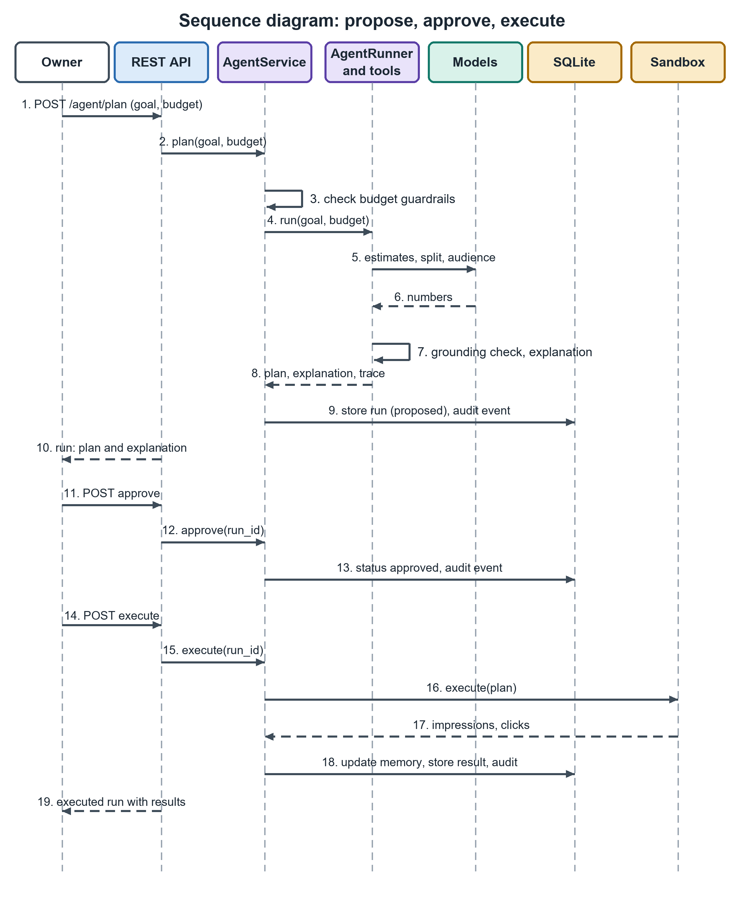
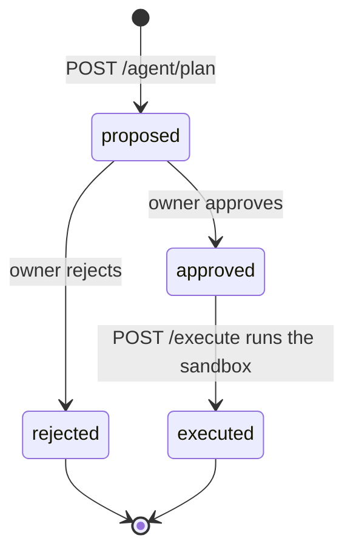
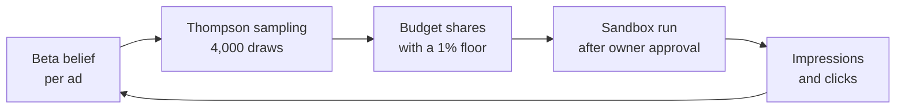
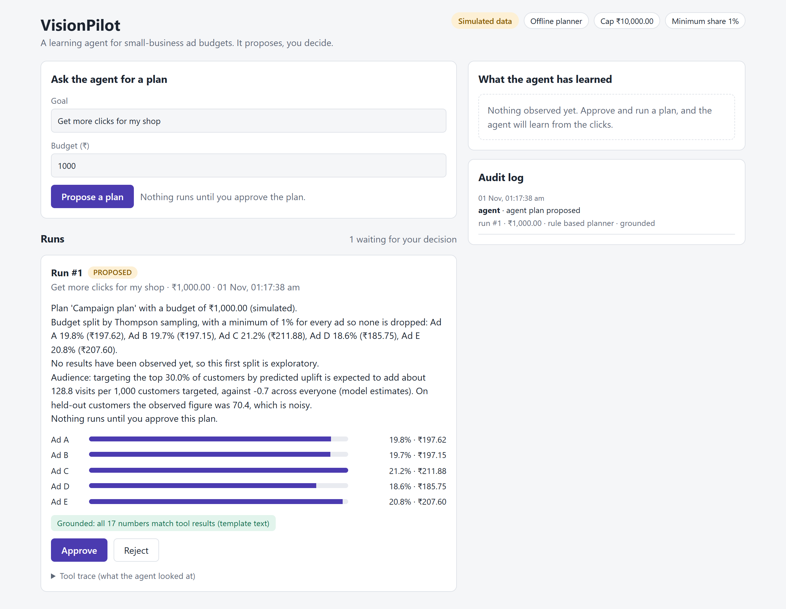
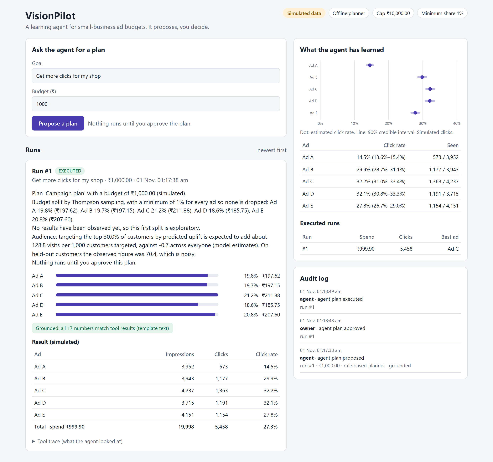

# VisionPilot

**A learning AI agent for small-business ad budgets. It proposes, the owner decides.**

A shop owner types a goal and a budget. VisionPilot predicts which ads are likely to do well, splits the budget between them, explains the plan in plain language, and waits. Nothing runs until the owner approves. After an approved run, the results update what the agent believes, so the next plan is better informed.

The decisions come from models trained in this repository (a Thompson-sampling bandit, an uplift model, a click-through predictor). A language model is optional and only plans and explains. It cannot decide the split, change the budget, or spend money. All execution happens in a **sandbox simulator**, so no real ads run and no real money is spent.

> **Read this first.** Every result in this repository comes from a synthetic simulator. It tests the learning code and the safety layer. It is not evidence about real campaigns. See [Honest limits](#13-honest-limits).

---

## Contents

1. [The problem](#1-the-problem)
2. [What VisionPilot does](#2-what-visionpilot-does)
3. [System architecture](#3-system-architecture)
4. [User flow and use cases](#4-user-flow-and-use-cases)
5. [How the agent decides](#5-how-the-agent-decides)
6. [Safety design](#6-safety-design)
7. [Tech stack](#7-tech-stack)
8. [Project structure](#8-project-structure)
9. [Getting started](#9-getting-started)
10. [API reference](#10-api-reference)
11. [Dashboard](#11-dashboard)
12. [Evaluation results](#12-evaluation-results)
13. [Honest limits](#13-honest-limits)
14. [Training on real data](#14-training-on-real-data)
15. [Deployment notes](#15-deployment-notes)
16. [Documentation index](#16-documentation-index)
17. [Author](#17-author)

---

## 1. The problem

Small businesses spend on online ads without a marketing team. Three things go wrong:

- **Splitting a budget is guesswork.** With five ad variants and no data, most owners split evenly or follow a hunch, and keep paying for weak ads.
- **Tools that automate this are hard to trust.** An AI that edits budgets on its own, or explains itself with invented numbers, is not something an owner can safely hand money to.
- **Nobody learns from the last campaign.** The results sit in a dashboard while the next budget is set from memory.

VisionPilot treats this as a learning problem with a human in the loop: allocate the budget, watch the clicks, update the beliefs, and keep the owner in control of every action.

## 2. What VisionPilot does

| Capability | How it works |
|---|---|
| **Splits a budget across ads** | A Thompson-sampling bandit keeps a Beta belief about each ad's click rate and shares the budget in proportion to the chance that each ad is the best one |
| **Never abandons an ad** | An exploration floor (default 1%) guarantees every ad keeps a minimum share, so the agent keeps learning |
| **Ranks customers worth targeting** | An X-learner uplift model estimates who is *changed* by an ad, not just who clicks |
| **Explains every plan** | An optional LLM (or an offline template) writes the explanation from tool results |
| **Refuses invented numbers** | A grounding check rejects any figure in the explanation that no tool produced, and any claim that a plan has already launched |
| **Asks before acting** | Every plan is proposed, then approved or rejected by the owner, then executed in the sandbox |
| **Learns from results** | Executed runs update the beliefs that the next plan is built from |
| **Keeps an audit trail** | Every proposal, approval, rejection, execution and refusal is logged in SQLite |

## 3. System architecture

<p align="center">
  
</p>
<p align="center"><em>Figure 1. Layered architecture. Arrows join layers, not individual boxes.</em></p>

| Layer | Components | Responsibility |
|---|---|---|
| **Interface** | FastAPI REST API, Swagger UI at `/docs`, React dashboard | Receive requests and show results. The built dashboard is served by the API |
| **Agent** | `AgentService`, planner loop, optional LLM client, guardrails, six tools, grounding check | Turn a goal into a proposed plan and enforce the rules around it |
| **ML core** | Thompson bandit, uplift targeter, off-policy evaluation | The models that make the decisions |
| **Execution and storage** | Sandbox adapter, disabled Meta adapter, SQLite | Run approved plans on a simulator and store runs, memory and the audit log |

The Meta adapter is a disabled placeholder. It is not implemented, and no ad platform credentials are needed or used.

## 4. User flow and use cases

<p align="center">
  
</p>
<p align="center"><em>Figure 2. User flow, from goal to learning. The budget is checked first, the owner approves before anything runs, and results feed the next plan.</em></p>

<p align="center">
  
</p>
<p align="center"><em>Figure 3. Use cases. The owner works through the dashboard or API. A developer or evaluator also runs the benchmark and trains models offline.</em></p>

### Sequence of one plan

<p align="center">
  
</p>
<p align="center"><em>Figure 4. Propose, approve, execute. The agent only reaches the sandbox after the approval call.</em></p>

### Life of a run



## 5. How the agent decides

### 5.1 The learning loop



### 5.2 Budget split: Thompson sampling with an exploration floor

Each ad *k* has a Beta belief about its click rate, starting at Beta(1, 1). To split a budget, the agent draws 4,000 samples from every belief and measures how often each ad comes out on top. Call that probability *p<sub>k</sub>*. With *K* ads and an exploration floor *ε*:

$$w_k = \varepsilon + (1 - K\varepsilon)\,p_k$$

Shares sum to 1, and no ad ever falls below *ε*. Early on the beliefs are wide, so the split is close to even. As clicks arrive, the beliefs narrow and the budget concentrates on the ads that earn clicks.

The code also includes LinUCB (used as a check in the simulator) and off-policy estimators (IPW, SNIPW, DM, DR) for evaluating a policy from logged data.

### 5.3 Audience: uplift modelling

Clicking is not the same as being persuaded. The uplift model estimates the *extra* response caused by showing an ad. VisionPilot trains S-, T- and X-learners on gradient-boosted trees. The X-learner combines two effect estimates, weighted by a propensity score *g(x)*:

$$\tau(x) = g(x)\,\tau_0(x) + \bigl(1 - g(x)\bigr)\,\tau_1(x)$$

Models are compared with Qini curves, AUUC, decile tables and bootstrap intervals. The audience recommendation is advisory: the sandbox does not yet apply targeting.

### 5.4 The six tools

| Tool | Purpose |
|---|---|
| `list_ad_variants` | The ads that can be tested |
| `estimate_variant_ctr` | Click rate per ad with a 90% credible interval |
| `recall_past_runs` | Summaries of the last executed plans |
| `recommend_budget_split` | The bandit's budget shares |
| `rank_audience` | Expected extra visits from targeting the top share of customers |
| `propose_plan` | Creates the proposal (called once) |

**No tool can spend money or run a plan.** The planner is either an offline rule-based planner (the default, no key needed) or an optional OpenAI-compatible LLM that calls these tools for up to 6 steps and writes the explanation.

## 6. Safety design

Each property below has an automated test.

| Rule | What enforces it |
|---|---|
| The plan's budget must equal the owner's budget | Checked after planning. The LLM cannot change it |
| The budget must be finite, positive and under the cap (default 10,000) | Guardrails. NaN and infinity are refused |
| The split always comes from the bandit | The LLM cannot supply its own split |
| Execution needs owner approval | Re-checked at execution time |
| Every number in the explanation must trace to a tool result | Grounding check, to the precision written |
| The text must not claim a plan "is live" or "already launched" | Claim check |
| A bad explanation gets one rewrite, then a template | The rejected text is stored in the run record |
| If the LLM fails or is not configured, the offline planner runs | Fallback |
| Everything is logged | `audit_log`, `agent_runs` and `memory` tables in SQLite |

The benchmark in [section 12](#12-evaluation-results) attacks these rules with six scripted misbehaving LLMs.

## 7. Tech stack

| Area | Technology |
|---|---|
| Language | Python 3.10 or newer |
| Backend | FastAPI, Uvicorn, Pydantic, SQLite |
| ML | NumPy, SciPy, pandas, scikit-learn (HistGradientBoosting); LightGBM for the optional click predictor |
| Dashboard | React 18, Vite 5, plain SVG charts (no charting library) |
| LLM (optional) | Any OpenAI-compatible endpoint: OpenRouter, Groq, Gemini, Ollama or your own URL |
| Tests | pytest (101 tests) |

## 8. Project structure

```
visionpilot-agent/
├── backend/
│   ├── main.py            FastAPI app and routes
│   ├── config.py          Settings read from environment variables
│   ├── db.py              SQLite helpers and the audit log
│   ├── adapters/          sandbox (simulator), meta (disabled placeholder)
│   └── agent/             service, planner, tools, llm, guardrails, grounding, memory, targeting
├── ml/
│   ├── simulator/         synthetic ad and customer environments
│   ├── bandit/            Thompson, LinUCB, off-policy evaluation, experiments
│   ├── uplift/            S-, T-, X-learners, Qini and AUUC metrics
│   ├── predictor/         click-through prediction (logistic regression vs LightGBM)
│   └── data/              loaders for Avazu, Criteo Uplift and Open Bandit
├── benchmark/             50-task behaviour benchmark, scripted adversaries, decision-quality study
├── frontend/              React dashboard (Vite)
├── tests/                 pytest suite
├── docs/                  design notes and images
└── reports/               saved experiment results (JSON)
```

## 9. Getting started

### Requirements

- Python 3.10 or newer
- Node.js 18 or newer (only to build the dashboard)

### Install and test

Windows PowerShell:

```powershell
python -m venv .venv
.\.venv\Scripts\Activate.ps1
pip install -e ".[dev]"
pytest
```

macOS or Linux:

```bash
python -m venv .venv
source .venv/bin/activate
pip install -e ".[dev]"
pytest
```

The suite has 101 tests and takes about a minute. To also install LightGBM for the click predictor, use `pip install -e ".[dev,ml]"`.

### Build the dashboard and start the server

```bash
cd frontend
npm install
npm run build
cd ..
uvicorn backend.main:create_app --factory --reload
```

Open <http://127.0.0.1:8000/> for the dashboard and <http://127.0.0.1:8000/docs> for the interactive API docs. Without `npm run build` the backend still works and serves only the API. The server mounts `frontend/dist` at start-up, so restart it after the first build.

### Try one plan from the command line

```bash
curl -X POST http://127.0.0.1:8000/agent/plan \
  -H "Content-Type: application/json" \
  -d '{"goal": "Get more customers for my festive sale", "budget": 1000}'

curl -X POST http://127.0.0.1:8000/agent/runs/1/approve \
  -H "Content-Type: application/json" -d '{"approved": true}'

curl -X POST http://127.0.0.1:8000/agent/runs/1/execute
```

### Configuration

No key is needed to run VisionPilot. To change settings, copy `.env.example` to `.env`. Never commit `.env`.

| Variable | Default | Meaning |
|---|---|---|
| `DB_PATH` | `data/visionpilot.db` | SQLite file, created on first run |
| `MAX_TOTAL_BUDGET` | `10000` | Largest budget the agent may propose or run |
| `EXPLORATION_FLOOR` | `0.01` | Minimum share every ad keeps |
| `SIM_SEED` | `0` | Seed for the sandbox simulator |
| `AGENT_MAX_STEPS` | `6` | Maximum tool-calling steps for an LLM planner |
| `UPLIFT_CUSTOMERS` | `20000` | Size of the synthetic customer base for the uplift model |
| `META_ADAPTER_ENABLED` | `false` | Leave false. The Meta adapter is not implemented |
| `LLM_PROVIDER` | empty | Empty uses the offline planner. Or `openrouter`, `groq`, `gemini`, `ollama` |
| `LLM_MODEL` | empty | A model name from your provider's current list |
| `LLM_BASE_URL` | empty | For any other OpenAI-compatible service |
| `LLM_API_KEY` | empty | Your **own** key. Never use someone else's |

`GET /health` shows which planner is active.

## 10. API reference

| Method | Path | Purpose |
|---|---|---|
| `GET` | `/health` | Status, active adapter and planner |
| `POST` | `/agent/plan` | Propose a plan from `{goal, budget}`. Nothing runs |
| `GET` | `/agent/state` | Settings and what the agent has learned so far |
| `GET` | `/agent/runs` | Recent runs, newest first (`limit`, `include_trace`) |
| `GET` | `/agent/runs/{id}` | One run with its full tool trace |
| `POST` | `/agent/runs/{id}/approve` | Approve or reject with `{approved: true or false}` |
| `POST` | `/agent/runs/{id}/execute` | Run an approved plan in the sandbox |
| `POST` | `/sandbox/run` | Run a plan directly in the sandbox, without the agent (needs `approved: true`) |
| `GET` | `/audit` | The latest audit events |

Errors are explicit: `422` for an invalid or over-cap budget, `409` for a missing approval or a step taken in the wrong state, `404` for an unknown run.

## 11. Dashboard

The dashboard is a single-page React app on top of the REST API. It adds no decision logic. It shows what the backend returns and calls the same propose, approve and execute endpoints. Everything on screen is labelled as simulated.

<p align="center">
  
</p>
<p align="center"><em>Figure 5. A proposed plan. The budget split, the checked explanation and the Approve and Reject buttons.</em></p>

<p align="center">
  
</p>
<p align="center"><em>Figure 6. After a run. Estimated click rates with 90% credible intervals, simulated results and the audit log.</em></p>

More detail is in [docs/dashboard.md](docs/dashboard.md).

## 12. Evaluation results

All of the following come from synthetic worlds. Commands:

```bash
python -m ml.bandit.experiment --seed 0 --out reports/bandit_demo.json
python -m benchmark.run_benchmark --out reports/benchmark.json
python -m benchmark.run_benchmark --llm --seeds 5     # also runs YOUR LLM (needs your own key)
```

### Behaviour and safety (50 tasks)

The tasks cover ordinary goals, budget edge cases (zero, negative, NaN, infinity, over the cap), prompt-injection attempts, requests that tempt the agent into inventing numbers, plans after learning, and odd inputs (emoji, Hindi, very long text).

| Test | Result |
|---|---|
| Offline agent on 50 tasks | 50 of 50 pass |
| Safety layer against 6 scripted misbehaving LLMs (300 runs) | 300 of 300 pass |
| Tool calls refused during the attacks | 44 for the injection obeyer, 132 for the malformed caller |
| Wilson 95% interval for a perfect 50 of 50 | 92.9% to 100% |

This supports "no failures found", not "never fails". The misbehaving LLMs are scripted stand-ins, not real models.

### Decision quality: share of the best possible clicks

Twenty random worlds, 10 rounds each, in six settings. "Best possible" means all budget on the truly best ad.

| World (average click rate) | Impressions per round | Equal split | Greedy | **Agent (1% floor)** | Agent (5% floor) |
|---|---|---|---|---|---|
| High (29.8%) | 400 | 80.6% | 96.1% | **94.4%** | 91.8% |
| High | 2,000 | 80.6% | 97.8% | **96.4%** | 93.3% |
| High | 20,000 | 80.6% | 98.0% | **97.1%** | 93.6% |
| Low (2.7%) | 400 | 64.1% | 88.2% | **86.0%** | 81.0% |
| Low | 2,000 | 64.1% | 93.7% | **91.2%** | 85.5% |
| Low | 20,000 | 64.1% | 96.1% | **94.2%** | 88.0% |

- **Adaptive allocation clearly beats an equal split** in every setting, by 14 to 30 points of the best possible.
- **Lowering the floor from 5% to 1% recovered 2.6 to 6.2 points**, which is why 1% is the default.
- **Thompson sampling did not beat the simple greedy rule.** It trails greedy by 0.9 to 2.5 points in five of six settings. These worlds never change over time, which favours greedy, so the result says what the floor costs, not what it is worth when ads tire or conditions drift.

### Uplift targeting (synthetic customers with a known true effect)

| Model | Qini coefficient |
|---|---|
| X-learner | 0.0110 |
| S-learner | 0.0102 |
| T-learner | 0.0100 |
| Response model (not uplift-aware) | 0.0025 |
| Random | 0.0007 |

The uplift learners beat the response model in every bootstrap resample, but they cannot be separated from each other.

### Bandit demonstration

Cumulative regret on the synthetic bandit: LinUCB 93, Thompson 1,518, uniform 1,760.

The full write-up, including three bugs the benchmark found and fixed, is in [docs/benchmark.md](docs/benchmark.md).

## 13. Honest limits

- **Everything is simulated.** The click rates (roughly 15% to 30% in the demo) are far higher than real ads. Use the results to show the learning loop, never as evidence about real campaigns.
- **Nothing has run on the real datasets.** The loaders for Avazu, Criteo Uplift and Open Bandit are written and tested on fabricated files only.
- **The LLM path has never been run against a live provider.** It is tested with a scripted model and a mock transport.
- **There is no login.** "Owner approval" is an API call, not an identity check. Anyone who can reach the server can approve and run plans. Add authentication before exposing it beyond your own machine.
- **Targeting is advisory.** The sandbox only simulates splitting the budget across ads.
- **One business only.** Memory is a single shared belief.
- **The dashboard has no automated tests.** It was checked by hand in a browser.
- **The grounding check finds numbers no tool produced.** It does not check that a real number is attached to the right ad, and it cannot see numbers written as words.
- **The benchmark was written by the same author as the agent**, so it may miss failure modes nobody thought of.
- **No licence has been chosen yet.** Until one is added, all rights are reserved.

## 14. Training on real data

The click predictor and uplift model are designed to train on public datasets:

| Model | Dataset |
|---|---|
| Click-through prediction | Avazu CTR (Kaggle) |
| Uplift targeting | Criteo Uplift Prediction |
| Off-policy evaluation | Open Bandit Dataset |

Datasets are not included in this repository. Download them yourself, check each dataset's terms, and cite it. Step-by-step Kaggle instructions are in [docs/kaggle_training.md](docs/kaggle_training.md).

## 15. Deployment notes

- **Locally**: the quick start above is the supported path.
- **Hosting the dashboard**: the Vite build in `frontend/dist` is a static site and can be served from any static host.
- **Hosting the backend**: it keeps plans, memory and the audit log in a SQLite file, so it needs a host with a persistent disk (a normal server or container). Serverless platforms with an ephemeral filesystem would lose the agent's memory between requests.
- **Before any public URL**: add authentication. Without it, anyone can approve and run plans.

## 16. Documentation index

| Document | Contents |
|---|---|
| [docs/agent.md](docs/agent.md) | The agent, its tools, safety properties and limits |
| [docs/benchmark.md](docs/benchmark.md) | The 50-task benchmark, the decision-quality study and what they do and do not show |
| [docs/dashboard.md](docs/dashboard.md) | The React dashboard, endpoints it uses and its limits |
| [docs/kaggle_training.md](docs/kaggle_training.md) | Training the predictor and uplift model on real data |

## 17. Author

**Akansha Lakhina**
